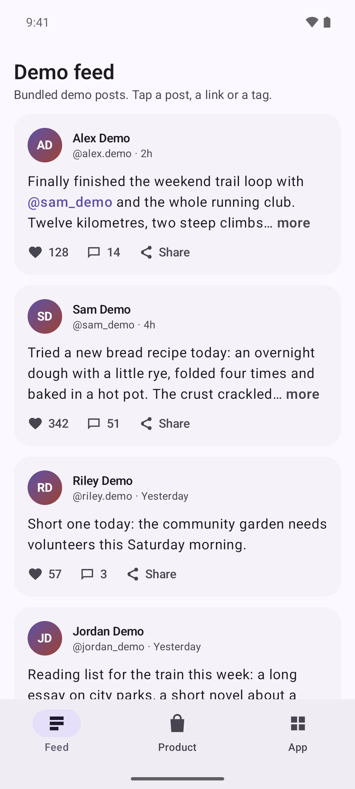
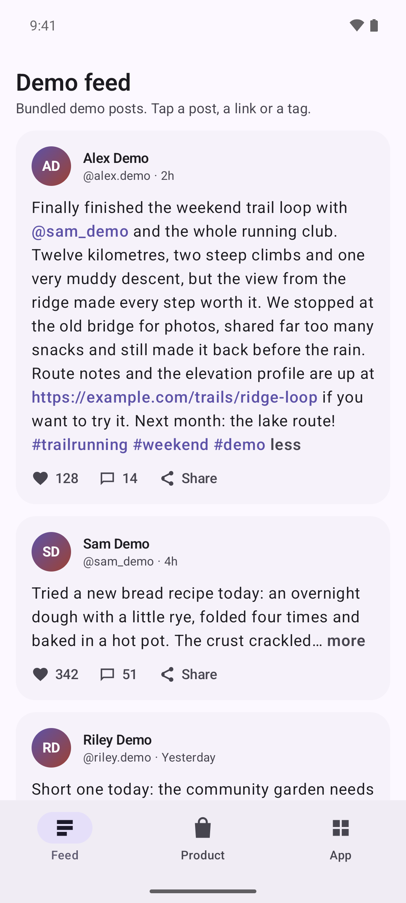
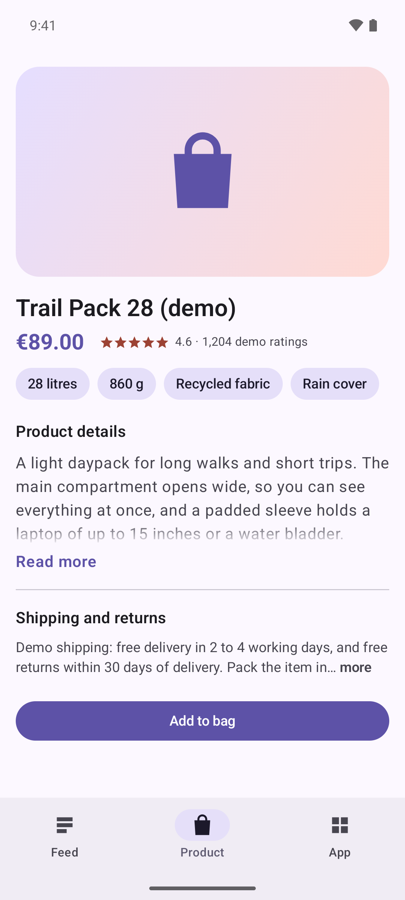
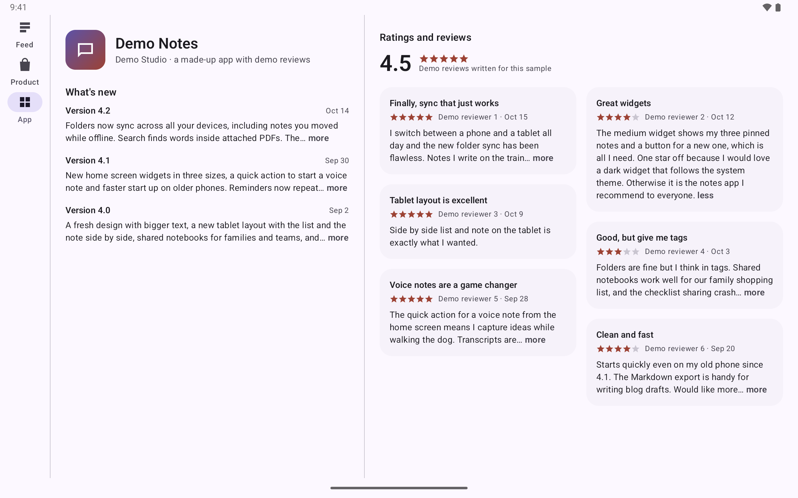

<p align="center">
  
</p>

<p align="center">
  <a href="https://github.com/halilozel1903/compose-expandable-text/actions/workflows/ci.yml"></a>
  <a href="https://jitpack.io/#halilozel1903/compose-expandable-text"></a>
  
  
  
  
  <a href="LICENSE"></a>
</p>

**compose-expandable-text** is "read more" text for Jetpack Compose. `ExpandableText` shows a few lines and expands to show the rest. It measures the text with a `TextMeasurer` and cuts it at the end of a word, so the inline "… more" label fits on the last line instead of being clipped or pushed to a new one. The height animates when the text expands and collapses, and an optional "less" label collapses it again. There's also a fade style, where the last line fades out and the label sits under the text. URLs, @mentions and #hashtags become `LinkAnnotation`s with callbacks. The expanded state is saveable, measurements are cached so feeds in a `LazyColumn` scroll smoothly, right-to-left text works, and TalkBack reads the whole text with expand and collapse actions. The truncation logic is in a small pure Kotlin module with unit tests.

```kotlin
ExpandableText(
    text = post.body,
    collapsedMaxLines = 3,                          // "… more" goes at the end of line 3
    onMentionClick = { name -> openProfile(name) },
    onHashtagClick = { tag -> openTag(tag) },
)
```

## Screenshots

CI captures these from the sample app on Android emulators. **All content in the sample is demo data bundled with the app:** demo people ("Alex Demo", `@sam_demo`) in a demo feed, a demo product ("Trail Pack 28 (demo)") and the release notes and reviews of "Demo Notes", an app that doesn't exist. Every link points at `example.com`, and the reviews were written for the sample. Nothing comes from a real social network, shop, app store or person.

| Feed, collapsed | One post expanded | Fade style |
| :---: | :---: | :---: |
|  |  |  |

**Tablet:** on a Pixel Tablet in landscape the store page of the made-up app puts its release notes beside a two column grid of reviews, one of them expanded.



## Features

- **Word boundary truncation.** The collapsed text is measured with `TextMeasurer` and cut at the end of the last word that leaves room for "… more" on the last line. Trailing spaces and punctuation are dropped before the ellipsis. A line that is one long word or URL is cut between characters, and emoji are never split.
- **Inline label or fade.** `CollapsedStyle.InlineLabel` puts "… more" right after the cut. `CollapsedStyle.Fade` fades out the last line and puts the label under the text.
- **Animated expand and collapse.** The height animates with a spring you can replace. It snaps when the user has turned animations off. An optional "less" label (`labels.less`) collapses the text again, and a tap anywhere outside a link toggles it.
- **Links, mentions and hashtags.** URLs, `@mentions` and `#hashtags` become `LinkAnnotation`s. URLs open in the browser unless you pass `onUrlClick`. Mentions and hashtags call `onMentionClick` and `onHashtagClick`. You can also pass your own `AnnotatedString` with any links and styles.
- **Saveable state.** `rememberExpandableTextState()` survives rotation, process death and items that scroll out of a lazy list and back.
- **Smooth in lazy lists.** Truncation results are cached by text, style, width, line limit and labels in `LocalExpandableTextCache`, so an item that scrolls back is not measured again. Link callbacks don't rebuild the text when they change.
- **Right-to-left text.** Lines, the cut and the label follow the layout direction.
- **Accessibility.** TalkBack reads the whole text even while it's collapsed, never the ellipsis or the label. It also announces a "Collapsed" or "Expanded" state and offers expand and collapse actions, plus a custom action for each link. You can translate all strings with `ExpandableTextDescriptions`.
- **Pure Kotlin core** (`compose-expandable-text-core`). Word boundary truncation, token detection and the LRU cache are all unit tested.

## Installation

Add JitPack to `settings.gradle.kts`:

```kotlin
dependencyResolutionManagement {
    repositories {
        google()
        mavenCentral()
        maven("https://jitpack.io")
    }
}
```

Then add the dependency:

```kotlin
dependencies {
    implementation("com.github.halilozel1903.compose-expandable-text:compose-expandable-text:1.0.0")

    // Pure Kotlin logic only (truncation, tokens):
    // implementation("com.github.halilozel1903.compose-expandable-text:compose-expandable-text-core:1.0.0")
}
```

> The build is also set up for Maven Central (`io.github.halilozel1903:compose-expandable-text`) through the vanniktech publish plugin.

## Usage

**A feed of posts**

```kotlin
LazyColumn {
    items(posts, key = { it.id }) { post ->
        ExpandableText(
            text = post.body,
            collapsedMaxLines = 3,
            style = MaterialTheme.typography.bodyLarge,
            onUrlClick = { url -> openInApp(url) },          // without it, URLs open in the browser
            onMentionClick = { name -> openProfile(name) },  // "sam_demo", without the @
            onHashtagClick = { tag -> openTag(tag) },        // "baking", without the #
        )
    }
}
```

Each item remembers its own state by key, so a post you expanded is still expanded after you scroll away and back.

**Fade style with "Read more" under the text**

```kotlin
ExpandableText(
    text = product.description,
    collapsedMaxLines = 4,
    collapsedStyle = CollapsedStyle.Fade,
    labels = ExpandableTextLabels(more = "Read more", less = "Read less"),
    labelStyle = SpanStyle(color = MaterialTheme.colorScheme.primary, fontWeight = FontWeight.SemiBold),
)
```

**Hoisted state and your own `AnnotatedString`**

```kotlin
val state = rememberExpandableTextState()

ExpandableText(
    text = buildAnnotatedString {
        withStyle(SpanStyle(fontWeight = FontWeight.Bold)) { append("Version 4.2  ") }
        append(notes)
    },
    state = state,
    collapsedMaxLines = 2,
    labels = ExpandableTextLabels(less = null),   // stays open, like store release notes
    onExpandedChange = { expanded -> analytics.log("notes_expanded", expanded) },
)
TextButton(onClick = state::toggle) { Text(if (state.expanded) "Hide" else "Show all") }
```

**Translated labels and TalkBack strings**

```kotlin
ExpandableText(
    text = body,
    labels = ExpandableTextLabels(more = "mehr", less = "weniger"),
    descriptions = ExpandableTextDescriptions(
        collapsed = "Eingeklappt",
        expanded = "Ausgeklappt",
        expandAction = "Mehr anzeigen",
        collapseAction = "Weniger anzeigen",
        openLink = { "$it öffnen" },
    ),
)
```

### `ExpandableText` parameters

| Parameter | Default | What it does |
| --- | --- | --- |
| `text` | | A `String` (links are detected) or an `AnnotatedString` (your links and styles) |
| `collapsedMaxLines` | `3` | Lines shown while collapsed |
| `state` | `rememberExpandableTextState()` | Whether it is expanded; saveable |
| `style`, `color` | `LocalTextStyle`, unspecified | The text style and color |
| `collapsedStyle` | `InlineLabel` | `InlineLabel` ("… more" on the last line) or `Fade` (label under the text) |
| `labels` | `more`, `less`, `…`, space | `ExpandableTextLabels`. `less = null` hides the collapse label |
| `labelStyle` | semibold, `onSurfaceVariant` | The `SpanStyle` of the labels |
| `linkStyles` | primary, underlined when pressed | `TextLinkStyles` for URLs, mentions and hashtags (`String` overload) |
| `linkKinds` | all | Which `TokenKind`s to detect (`String` overload) |
| `onUrlClick`, `onMentionClick`, `onHashtagClick` | `null` | Link callbacks (`String` overload) |
| `animationSpec` | spring | How the height changes. It snaps when animations are off |
| `fadeLength` | one line | How far the fade reaches |
| `toggleOnTextClick` | `true` | Whether a tap outside links toggles the text |
| `descriptions` | English | `ExpandableTextDescriptions` for TalkBack |
| `onExpandedChange` | `null` | Called after the user expands or collapses the text |

### Other API

| API | What it does |
| --- | --- |
| `ExpandableTextState`, `rememberExpandableTextState(initiallyExpanded)` | `expanded`, `expand()`, `collapse()`, `toggle()` and a `Saver` |
| `linkify(text, styles, kinds, onUrlClick, onMentionClick, onHashtagClick)` | An `AnnotatedString` with `LinkAnnotation`s for URLs, mentions and hashtags |
| `rememberLinkifiedText(...)` | `linkify`, remembered. Callbacks can change without rebuilding the text |
| `ExpandableTextDefaults` | `labelStyle()`, `linkStyles()`, `AnimationSpec`, `FadeLength`, `LABEL_TAG` |
| `ExpandableTextCache`, `LocalExpandableTextCache` | The truncation cache (256 entries, shared by default). Provide your own to size or scope it |
| `CollapsedStyle`, `ExpandableTextLabels`, `ExpandableTextDescriptions` | Style, labels and accessibility strings |

## The core module

`compose-expandable-text-core` doesn't depend on Android or Compose. The composable is built on it, and you can use it in tests or with other UI toolkits. `Truncation` doesn't measure anything itself. It asks a `fits(end)` callback whether a prefix plus the suffix still fits, and binary searches over word ends:

```kotlin
// The last visible line runs from 0 to 19; each character is one unit wide, a line holds 20.
Truncation.findCut("The quick brown fox jumps over the lazy dog", lineStart = 0, lineEnd = 19) { end ->
    end + "… more".length <= 20
}                                                                  // 9: "The quick… more"
Truncation.breakCandidates("one two-three", 0, 13)                 // 3, 8, 13
Truncation.trimEnd("Hello, world", 6)                              // 5
TextTokens.find("Thanks @sam_demo! #baking https://example.com")   // Mention, Hashtag, Url
MeasureCache<String, Int>(maxSize = 64).getOrPut("key") { 42 }
```

| API | What it does |
| --- | --- |
| `Truncation.findCut(text, lineStart, lineEnd, fits)` | The end of the prefix to show before the suffix: the last fitting word end, then a character cut, then the line start |
| `Truncation.breakCandidates`, `trimEnd`, `splitsSurrogatePair` | Word ends, trailing space and punctuation, emoji safety |
| `TextTokens.find(text, kinds)` | URLs (sentence punctuation and unbalanced parentheses trimmed), mentions (not emails), hashtags (any script, at least one letter) |
| `MeasureCache` | A small thread safe LRU cache |

## Sample app

The `sample` module has three screens, all built from **demo data** in [`DemoData.kt`](sample/src/main/kotlin/io/github/halilozel1903/expandabletext/sample/DemoData.kt):

- **Feed**: demo posts collapsed to three lines with an inline "… more". Mentions, hashtags and example.com links are highlighted, and tapping them shows a snackbar.
- **Product**: a demo product page. The description uses the fade style with "Read more", and the shipping notes use the inline label.
- **App**: a store page for "Demo Notes", a made-up app. Release notes collapse to two lines with no "less", and demo reviews collapse to three. On tablets the reviews are in a two column staggered grid beside the release notes.

Phones get a bottom navigation bar. Screens 840 dp and wider get a navigation rail. The sample opens a fixed screen from an intent extra, which `scripts/screenshots.sh` uses:

```bash
./gradlew :sample:installDebug
adb shell am start -n io.github.halilozel1903.expandabletext.sample/.MainActivity --es scene fade
```

`scene` is one of `feed`, `expanded`, `fade` or `tablet-reviews`. Each scene logs `SCENE_READY <scene>` once it has settled. CI waits for that line, then captures the phone scenes on a Pixel 7 and `tablet-reviews` on a Pixel Tablet in landscape. It checks each capture for the screen's text and fails on blank images.

## Project structure

| Module | What it is |
| --- | --- |
| `expandable-text-core` | Pure Kotlin: truncation, token detection, LRU cache. Published as `compose-expandable-text-core` |
| `expandable-text` | Compose: `ExpandableText`, `linkify`, state and defaults. Published as `compose-expandable-text` |
| `sample` | A demo feed, product page and store page, with screenshot scenes |

## Tech stack

Kotlin 2.4 · AGP 9.4 with built-in Kotlin · Gradle 9.6 · Jetpack Compose (BOM 2026.09) and Material 3 · `TextMeasurer`, `LinkAnnotation` and `animateContentSize` · GitHub Actions with Android emulators

## License

MIT. See [LICENSE](LICENSE).
